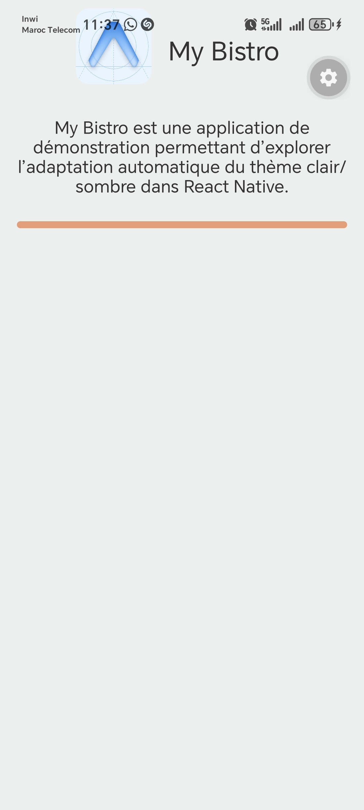
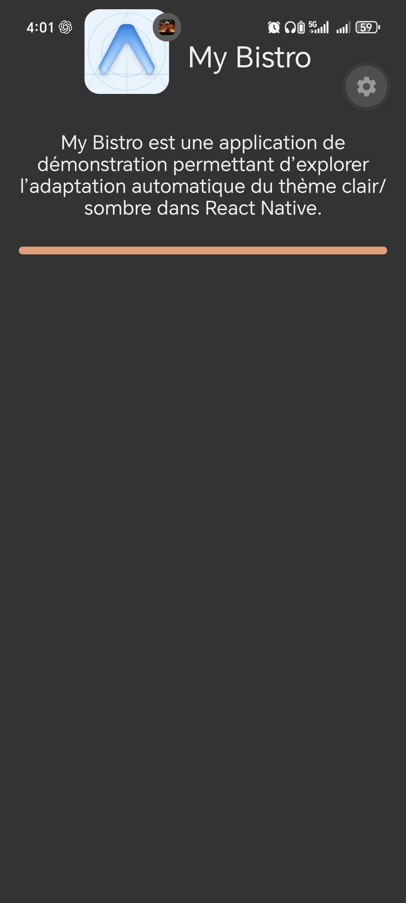

# Lab 9 — Thème clair et sombre avec useColorScheme

L’écran « My Bistro » suit automatiquement le thème du téléphone grâce à `useColorScheme`.

## Thème clair

Fond clair, texte foncé et barre d’accent couleur pêche.

## Thème sombre

Fond foncé, texte clair et barre d’accent couleur pêche.

